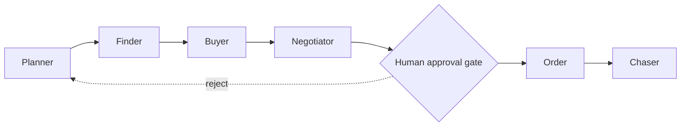

# BuildBuy Copilot

**One site, one buyer workflow:** upload a plan or just say what you need —
BuildBuy Copilot reads the plan, estimates the materials, finds nearby
suppliers, simulates the purchase, messages suppliers for quotes, negotiates
within your limits, and brings you one deal to approve — in 5 minutes, for
$19–$49/month, with no procurement team and no money moved without your tap.

**Live demo:** Deploy pending — see docs/DEPLOY.md. (No live link exists
yet; do not treat any URL as live until it has passed the smoke test in
`docs/DEPLOY.md` §4.)

**For:** freelance site engineers, solo architects, 1–3-person contractors,
small shop owners — anyone who needs materials for one job this week, has no
buying team, and cannot afford a late delivery or a wrong quantity.

## What it does (one dashboard, seven tabs)

1. **Start — the chat is the input** — upload a construction plan
   (JPG/PNG/PDF, ≤10 MB) **or** type / photograph the part or requirement
   in chat ("steel brackets, 50 units"), then quantity, location, deadline
   and budget as follow-up prompts in the same chat flow. Location is an
   optional field you fill in yourself (blank by default) — your location
   is never tracked.
2. **Plan & Materials** — Copilot answers with dual citations (highlighted
   plan region + exact spec clause) or an honest "not found"; materials
   takeoff with the method per line, labelled **"estimate, not a surveyed
   quantity"**.
3. **Suppliers & Twin** — ranked shortlist with cost AND quality per supplier
   (see [Cost AND quality](#best-cost-and-quality) below), map-like distance
   list, digital-twin what-if simulator (price/date/qty) showing cost risk
   AND quality risk. Optional delivery location (typed by you, blank by
   default) adds transport to total landed cost with a per-supplier
   breakdown; blank means "excl. transport".
4. **Buyer Agent** — 3-column inbox, draft email shown before sending,
   per-supplier contact-sharing toggle (default OFF), one negotiation round
   within your limits, Approve/Reject pane. Every supplier email says
   "BuildBuy Copilot, acting as the buying agent for [customer]" and
   enquires about the specific part + quantity. If a supplier asks a
   question the agent cannot answer from your requirement, it does NOT
   guess — it emails you, waits for your answer, and only then replies
   to the supplier in your words (see "Supplier questions" below).
5. **My Orders** — full timeline requirement → invoice, delivery chase,
   invoice tracking (invoice details recorded only from the supplier).
6. **Accuracy** — observability dashboard: 8 separate metrics (never
   blended into one score), each with formula, source, n= and target;
   4 headline cards; 2 trend charts with alert thresholds as dashed
   lines; per-module table; Worst Answers (10 lowest, each "Add to eval
   set" / "Mark fixed"); Eval Run History; drill-down to raw events.
   Live data from the backend when it is up, labelled synthetic demo
   data otherwise, "no data yet" when empty — never invented.
7. **Settings** — contact, sharing defaults, free-tier usage, BYO key status
   (never the key value), data export/delete.

## Accuracy — observability dashboard

The Accuracy tab answers one question: *is the copilot getting better
or worse?* It shows **8 separate metrics, never blended into one
score** — a problem in one module cannot hide behind another:

| # | Metric | Formula | Target |
|---|---|---|---|
| 1 | Groundedness | grounded answers ÷ all answers | ≥ 95% |
| 2 | Retrieval accuracy | RAG top-1 correct ÷ eval set (top-3 alongside) | top-1 ≥ 90% |
| 3 | Answer accuracy | 👍 ÷ (👍 + 👎); "not found" counted separately, never as a wrong answer | ≥ 90% |
| 4 | Takeoff estimate accuracy | mean absolute % error vs user-corrected quantities | mean error ≤ 10% |
| 5 | Supplier ranking accuracy | chosen supplier was ranked #1 | ≥ 50% |
| 6 | Buyer-agent accuracy | quotes agreed ÷ sent; **approval-before-order = 100%** (state-machine invariant, shown as the metric value; the agreement rate is shown separately) | approval-before-order 100% |
| 7 | Guardrail block rate | blocked ÷ adversarial inputs (false-positive rate tracked separately) | 100% on the adversarial set |
| 8 | Cost / cache / speed | cache hit rate, $ saved, latency p50/p95, cost per query / per job | cache hit ≥ 50%, p95 ask latency < 10 s |

Plus: 4 headline cards (groundedness, 👍 rate, takeoff error, cost per
job — the same 4 metrics, not a different score), 2 trend charts with
alert thresholds as **dashed lines** (groundedness 90%, retrieval top-1
85%, eval pass 90%, p95 latency 10 s), a per-module breakdown table, a
**Worst Answers** list (10 lowest — thumbs-down first, then ungrounded;
each row has "Add to eval set" and "Mark fixed", and a row already acted
on is never added twice), **Eval Run History** (a failed eval run blocks
the deploy via the CI regression gate), and a **drill-down** to raw
events (request_id, step, model, latency, grounded, cache hit, guardrail
action, cost — prompts, plan text and email bodies are never logged in
full and never shown).

- **Live mode** (backend up at `API_URL`): the tab fetches
  `GET /accuracy` from `app/observability.py` (`metrics_daily` +
  `eval_runs` + `qa_log` + `observability_events`). Empty metrics show
  **"no data yet"** — never a made-up percentage. Takeoff accuracy stays
  "no data yet" until a user actually corrects a takeoff line, because
  edits overwrite the quantity in place and no corrected-vs-estimate pair
  is recorded yet.
- **Demo mode** (no backend): labelled synthetic data, clearly marked —
  the tab says so, and the Worst Answers actions are noted locally
  instead of being written to the eval set.
- The loop is: evals → dashboard → Worst Answers / failing items → fix
  → re-run evals → the dashboard shows whether it improved. The
  dashboard never changes the product by itself.
- Details: [`docs/ARCHITECTURE.md`](docs/ARCHITECTURE.md) §10.
  UAT steps: [`docs/UAT.md`](docs/UAT.md) §6.

## Architecture

```mermaid
flowchart TD
    U[User — freelancer / small contractor] --> FE[Frontend: Streamlit app<br/>upload plan / type requirement<br/>chat Q&A, twin dashboard, approval screen]
    FE --> API[Backend: FastAPI<br/>REST + auth-lite, Pydantic schemas<br/>request validation, rate limits]
    API --> RAG[Hybrid Search RAG service<br/>TF-IDF + BM25 + FAISS embeddings<br/>plan passages + spec clauses + supplier docs]
    API --> VLM[Vision service<br/>VLM: plan image → regions, labels, scale<br/>photo requirement → item description]
    API --> TAKE[Takeoff engine<br/>area / count / length × rates<br/>materials + quantities, method shown]
    API --> SUP[Supplier search<br/>public directory + user-added suppliers<br/>location / distance / MOQ / lead-time filter]
    API --> TWIN[Digital Twin simulator<br/>landed cost, delivery date, risk<br/>what-if: price / date / qty slips]
    API --> AGENTS[Agent orchestration — LangGraph<br/>Planner → Finder → Buyer → Negotiator → Chaser<br/>human-approval gate between Negotiator and Order]
    AGENTS --> MAIL[Email service<br/>quote request, negotiation, confirmation,<br/>delivery chase — buyer's identity]
    AGENTS --> GUARD[Guardrails — every step<br/>PII redaction, price caps, deadline limits<br/>never-pay / never-order-without-approval]
    API --> CACHE[Semantic cache — Redis<br/>repeat plan questions + repeat supplier Qs<br/>served with no LLM call]
    API --> EVAL[Eval harness — generated eval sets<br/>groundedness, guardrail block rate,<br/>cache hit rate, retrieval accuracy]
    API --> DB[(Data: PostgreSQL / DuckDB<br/>requirements, plans, materials,<br/>suppliers, quotes, orders, audit log)]
    API --> LLM[LLM provider — pluggable<br/>OpenAI / Claude API, BYO key<br/>local fallback: TF-IDF + rules]
    FE --> U
    MAIL --> S[Suppliers — email / WhatsApp*]
    S --> MAIL
    *WhatsApp in Phase 2 only — needs Business API / buyer number; v1 is email-only.
```

Agentic graph:



Full architecture, data model, API list, and the cost+quality ranking
specification: [`docs/ARCHITECTURE.md`](docs/ARCHITECTURE.md).

## Modules — rebuild one alone

Each module is a separate section with its own public interface, its own
tests, and can be rebuilt / tested / replaced without touching the
others. Full map + per-module commands:
[`docs/MODULES.md`](docs/MODULES.md).

| Module | Files | Test it alone |
|---|---|---|
| RAG / retrieval | `app/rag/` | `pytest tests/test_rag.py -v` |
| VLM / plan parsing | `app/vlm/` | `pytest tests/test_vlm.py -v` |
| Takeoff engine | `app/takeoff/` | `pytest tests/test_takeoff.py -v` |
| Supplier search | `app/suppliers/` | `pytest tests/test_suppliers.py -v` |
| Digital Twin | `app/twin/` | `pytest tests/test_twin.py -v` |
| Ranking (cost + quality + landed cost) | `app/ranking.py` | `pytest tests/test_ranking.py -v` |
| Buyer Agent / LangGraph | `app/agents/` | `pytest tests/test_backend.py -v` |
| Supplier-question escalation | `app/agents/escalation.py` | `pytest tests/test_escalation.py -v` |
| Email service | `app/email/` | `pytest tests/test_email.py -v` |
| Guardrails | `app/guardrails/` | `pytest tests/test_guardrails.py -v` |
| Semantic cache | `app/cache/` | `pytest tests/test_cache.py -v` |
| Evals | `app/evals/` | `pytest tests/test_evals.py -v` |
| LoRA | `app/lora/` | `pytest tests/test_lora.py -v` |
| Observability / Accuracy | `app/observability.py` (+ `GET /accuracy`, `POST /accuracy/worst-answers/{id}/action`) | `pytest tests/test_observability.py -v` |
| Records / summaries | `app/records/` | `pytest tests/test_records.py -v` |
| Frontend | `frontend/app.py`, `helpers.py`, `demo_data.py`, `accuracy.py` | `pytest tests/test_frontend.py -v` (pure helpers + real Streamlit AppTest render of the Accuracy tab when Streamlit is installed) |

Boundaries are enforced by `tests/test_modularity.py` (import map,
public interfaces, no auto-location code, no hard torch/faiss imports).
`app/integrations.py` is the one wiring module allowed to import every
AI module; everything else talks through `app/schemas.py`,
`app/config.py`, or `app/db/`.

## Best cost AND quality

The shortlist ranks by **best value = 0.45 × cost score + 0.35 × quality
score + 0.20 × lead-time score** — one canonical formula
(`app/suppliers/search.py::best_value_score`; `app/ranking.py` imports
it, it is not duplicated). Quality scores exist only where evidenced
(certifications, verified reviews, past orders); a supplier with no
evidence gets `quality_score = null` and `quality_unknown = true` —
never an invented rating. The approval pane returns **best-value,
cheapest, and highest-quality side by side**, each with cost + quality
+ evidence, so the user chooses. The twin simulates cost risk **and**
quality risk. Suppliers whose MOQ is above the job quantity are excluded
from the ranking and listed with the reason. See
[`docs/ARCHITECTURE.md` §5](docs/ARCHITECTURE.md#5-cost-and-quality-ranking-2026-11-10-update).

### Total landed cost — optional transport

**Total landed cost = goods (unit price × quantity) + transport
(distance × rate) + taxes/fees (where known)**, shown as a per-supplier
breakdown, so you can see why one supplier wins on total landed cost
even when its unit price is higher: the near supplier can beat the far
cheap one once freight is counted. Transport is **optional and manual**
— type a delivery location yourself (city / ZIP / address) on the
Suppliers tab; blank by default, toggleable off, or your own $/km rate.
Leave it blank and landed costs show **"excl. transport"**. Your
location is never auto-detected: no browser geolocation, no IP lookup,
and the requirement's job-site location is not auto-used for transport.

This is the same Total Landed Cost discipline Deepthi built at Ford
Motor Company (Supply Chain Analytics, 2023–2025) — comparing suppliers
on the full landed cost, not the unit price — applied here to a single
purchase by a freelancer or small contractor.

## Skills mapping — all 6 screenshot skills

| Reel skill | Module | File |
|---|---|---|
| 1. Hybrid Search RAG | Plan + spec retrieval; supplier-doc retrieval | `app/rag/retrieval.py` |
| 2. Agent Orchestration | Buyer workflow graph | `app/agents/graph.py` (LangGraph) |
| 3. Semantic Caching | Repeat-question cache | `app/cache/semantic_cache.py` (Redis) |
| 4. Automated Eval Dataset Generator | Eval harness | `app/evals/eval_gen.py` |
| 5. LoRA Fine-Tuning | Personal intent adapter | `app/lora/adapter.py` (PyTorch + PEFT) |
| 6. LLM Guardrails | Guardrail layer | `app/guardrails/guardrails.py` (Guardrails AI + Presidio) |

## Setup — local run (VS Code + Docker)

### Prerequisites

| What | Version / detail | Check |
|---|---|---|
| Python | **3.12.x** | `python --version` / `python3 --version` |
| Git | Any recent version | `git --version` |
| VS Code + extensions | Python, Pylance, Docker, YAML | Extensions tab |
| Docker Desktop | Latest, with Compose v2 | `docker --version`, `docker compose version` |
| Node.js | **Not needed in v1** (Streamlit frontend is Python-only) | — |

### Clone and install

```bash
git clone https://github.com/deepthivj-aiml/buildbuy-copilot.git
cd buildbuy-copilot
code .

# Windows (PowerShell)
py -3.12 -m venv .venv
.\.venv\Scripts\Activate.ps1
python -m pip install --upgrade pip
pip install -r requirements.txt

# Mac (Terminal)
python3.12 -m venv .venv
source .venv/bin/activate
python -m pip install --upgrade pip
pip install -r requirements.txt
```

In VS Code: Ctrl+Shift+P / Cmd+Shift+P → "Python: Select Interpreter" →
choose the `.venv` interpreter.

### `.env` setup — never commit `.env`

```bash
copy .env.example .env   # Windows
cp .env.example .env     # Mac
```

Fill in only the values you have. `LLM_API_KEY` (OpenAI **or** Claude, pick
one) and `RESEND_API_KEY` (only if `EMAIL_PROVIDER=resend`) are created by
signing in to the provider dashboard with deepthiag26@gmail.com. **The app
runs without any key** — local TF-IDF + rules, no VLM — at $0. Check
`git status` never lists `.env` before committing.

### Run WITHOUT Docker (simplest first run — two terminals)

```bash
# Terminal 1 — backend (FastAPI)
uvicorn app.main:app --reload --port 8000

# Terminal 2 — frontend (Streamlit)
streamlit run frontend/app.py --server.port 8501
```

| Service | URL | What you should see |
|---|---|---|
| Frontend (Streamlit) | http://localhost:8501 | BuildBuy Copilot home screen |
| Backend API docs | http://localhost:8000/docs | FastAPI Swagger UI with all endpoints |
| Backend health | http://localhost:8000/health | `{"status": "ok"}` |

Without Docker the database is the local SQLite file and the cache is the
in-memory fallback if Redis is not running — expected for a first run.
Without the backend, the frontend runs in clearly-labelled **DEMO MODE**
on synthetic data (no paid key, no real email).

### Run WITH Docker (reproducible run)

```bash
docker compose build
docker compose up -d
docker compose ps          # api, frontend, db, redis all Up / healthy
docker compose logs -f api # Ctrl+C stops following, not the containers
docker compose down        # stops, keeps data
docker compose down -v     # stops AND wipes local data — only when you mean it
```

| Service | Image / build | Port |
|---|---|---|
| `api` | `Dockerfile.api` (Python 3.12 + FastAPI) | `8000 → 8000` |
| `frontend` | `Dockerfile.frontend` (Python 3.12 + Streamlit) | `8501 → 8501` |
| `db` | `postgres:16-alpine` | `5432 → 5432` |
| `redis` | `redis:7-alpine` | `6379 → 6379` |

Volumes `postgres_data` and `redis_data` survive restarts. After a code
change: `docker compose up -d --build`.

### How to verify it works locally

1. Health: http://localhost:8000/health → `{"status": "ok"}`.
2. API docs: http://localhost:8000/docs — the endpoint list is visible.
3. Frontend loads: http://localhost:8501 — home screen, no error banner.
4. Sample plan: "Try with a sample plan" → confirm scale → ask "How many
   fixtures are on sheet A-101?" → answer with **both** citations or
   "not found" — never a bare answer.
5. Sample requirement: `steel brackets, 50 units, Fremont, by Friday, under
   $400` → parsed fields editable → ranked shortlist (cost AND quality) →
   twin simulation for the top 3.
6. Approval gate: buyer run with mocked email → draft shown before sending
   → **no order is created until you tap Approve**.
7. Tests: `pytest` green (locally or `docker compose exec api pytest`).

### Common errors (short form — full table in the plan, §8.8)

| Symptom | Fix |
|---|---|
| `Cannot connect to the Docker daemon` | Start Docker Desktop, wait for "Engine running" |
| `port is already allocated` (8000/8501/5432/6379) | Stop the other app, or change the host port in `docker-compose.yml` |
| `ModuleNotFoundError: No module named 'fastapi'` | Re-select the `.venv` interpreter; reinstall with the venv active |
| `.env` shows up in `git status` | Stop — fix `.gitignore` before any commit; rotate any key already committed |
| Streamlit "Connection refused" to the API | Start the API (Terminal 1) / `docker compose ps` — inside Docker the frontend talks to `http://api:8000` |
| `docker compose up` fails on `db` | Stop a local Postgres, or `docker compose down -v` (wipes local data) and retry |

## How to run tests

```bash
pytest -v                              # all tests (temp SQLite DB, mock email)
docker compose exec api pytest         # same, inside Docker
docker compose run --rm api pytest     # fresh throwaway container
```

Tests use a temp SQLite DB and the mock email backend — no real email, no
network, no invented data. CI (`.github/workflows/ci.yml`) runs pytest on
every push/PR with Python 3.12; lint (ruff/flake8) is non-blocking
(`continue-on-error`) when the tool is missing.

## Free deploy — $0/month

Primary: **Streamlit Community Cloud** (free) for the frontend;
**Neon / Supabase free tier** for Postgres; **Upstash / Redis Cloud free**
for cache; **Gmail SMTP** (or Resend free, 100 emails/day) for email.
Fallback: Render free tier. Total $0 with the caps stated in
[`docs/DEPLOY.md`](docs/DEPLOY.md) — Streamlit sleeps after inactivity,
Render spins down after 15 min idle, free DB/cache tiers are small, Gmail
has daily sending limits. **Deploy pending — see docs/DEPLOY.md.**

## Supplier questions — the agent never guesses (2026-11-10 update)

Every supplier email opens "I am BuildBuy Copilot, acting as the
buying agent for [customer]" and enquires about the specific part +
quantity (and deadline / budget where you gave them). When contact
sharing is OFF for that supplier, the customer is only "a customer" —
no name, email or phone. When you toggle **"Share my contact with
this supplier"** ON (Buyer Agent tab, per supplier, plain-words
explanation on screen), the email includes your name (Deepthi Jainlal),
email (deepthiag26@gmail.com) and phone (+1 341-252-9234) so the
supplier can reach you directly.

If a supplier asks a question the agent **cannot** answer from what
you already told it — payment terms, a price beyond your limits, a
spec, delivery changes, warranty, anything outside your requirement —
the agent does NOT guess:

1. The supplier question is recorded; the deal goes to status
   `NEEDS_CUSTOMER` — no reply is sent to the supplier.
2. You are emailed at deepthiag26@gmail.com with the supplier's exact
   question.
3. You answer in the app (`POST /requirements/{id}/buyer/escalations/{id}/reply`)
   or by replying to that email; the agent then replies to the supplier
   with **your words**, plus only its identity line.
4. Questions the agent *can* answer — confirming the part, quantity,
   delivery location, deadline or budget you already stated — are
   answered straight from the requirement, no escalation.

Endpoints: `POST /requirements/{id}/buyer/supplier-question`,
`GET /requirements/{id}/buyer/escalations`,
`POST /requirements/{id}/buyer/escalations/{id}/reply`.
Tests: `tests/test_escalation.py` (6 tests).

## Invoice tracking, email summary, records export

- **Invoices are recorded only from supplier-supplied data:**
  `POST /requirements/{id}/invoice` requires `invoice_number` and `amount`
  — no defaults, no auto-generation. Orders reach `INVOICE_RECEIVED` only
  when the supplier sends one; `POST /requirements/{id}/invoice/chase`
  chases an overdue (or never-sent) invoice.
- **Email summary:** summary emails go to the user (`USER_EMAIL`) after
  quotes received, deal approved, order confirmed, and invoice received —
  and on demand via `POST /requirements/{id}/summary` (includes the full
  records export).
- **Records export:** `GET /requirements/{id}/records?format=csv|json|summary`
  — requirement, plan, materials, suppliers, quotes, negotiation, approval,
  order, invoice, and audit log. The summary is a PDF when `reportlab` is
  installed, otherwise plain-text `.txt` — the export never fails for a
  missing optional dep.

## Limits, stated honestly

- No real supplier contacts, quotes, ratings, or invoices are invented.
- Quantities are estimates, not surveyed measurements.
- No payment is handled; the buyer pays the supplier directly.
- Delivery cannot be proven by the app — the chase is an email follow-up;
  arrival stays a human check.
- Nothing is ordered, confirmed, or paid without the user's tap.
- Supplier quality scores are shown only with their evidence; no rating is
  ever invented for a real supplier.
- Free-tier limits apply on deploy (Streamlit/Render sleep, small free
  DB/cache tiers, Gmail daily sending limits).

## Docs

- [`docs/ARCHITECTURE.md`](docs/ARCHITECTURE.md) — full architecture,
  data flow, API list, data model, agent graph, cost+quality ranking.
- [`docs/MODULES.md`](docs/MODULES.md) — module map: every module's
  files, public interface, and how to rebuild/test it alone.
- [`docs/BUILD_REPORT.md`](docs/BUILD_REPORT.md) — integration + test
  pass report (measured counts, wiring, smoke tests).
- [`docs/DEPLOY.md`](docs/DEPLOY.md) — free deploy ($0), smoke test.
- [`docs/UAT.md`](docs/UAT.md) — manual UAT checklist (40 items, phone-first).
- [`docs/FREE_MODELS.md`](docs/FREE_MODELS.md) — free/local models used by
  default (TF-IDF/BM25, local sentence-transformers, Ollama, Hugging Face
  free inference) and BYO paid options.

---

# BuildBuy Copilot — Backend

FastAPI + Pydantic v2 + SQLAlchemy + LangGraph backend for the one-buyer
workflow: plan Q&A → takeoff → supplier search → digital-twin simulation
→ buyer agent (email) → **human approval** → order → delivery chase →
invoice tracking.

## The two invariants

- **Never pay.** There is no payment tool anywhere in this codebase.
- **Never order without approval.** The graph cannot reach `Order`
  without a persisted `ApprovalRequest` in APPROVED status
  (`interrupt_before=["order"]` in LangGraph, plus a DB check in the
  order node as a second lock).

## Best cost AND quality (2026-11-10; reconciled 2026-11-11)

The shortlist ranks by **best value = 0.45 × cost score + 0.35 × quality
score + 0.20 × lead-time score** — one canonical formula
(`app/suppliers/search.py::best_value_score`; `app/ranking.py` imports
it). Quality scores exist only where evidenced (certifications,
verified reviews, past orders); a supplier with no evidence gets
`quality_score = null` and `quality_unknown = true` — never an invented
rating. The approval pane (`GET /requirements/{id}/approval`) returns
**best-value, cheapest, and highest-quality side by side**, each with
cost + quality + evidence, so the user chooses. The twin simulates
cost risk **and** quality risk.

**Total landed cost = goods + transport + taxes/fees**, with a
per-supplier breakdown. Transport is optional and manual — the buyer
types a delivery location (blank by default, never auto-detected); blank
means "excl. transport". Same Total Landed Cost discipline Deepthi built
at Ford (Supply Chain Analytics, 2023–2025), at single-job scale.

## Run

```bash
python3.12 -m venv .venv && source .venv/bin/activate
pip install -r requirements.txt
cp .env.example .env   # names only; fill in only what you have
uvicorn app.main:app --reload --port 8000
```

- Health: http://localhost:8000/health
- Docs: http://localhost:8000/docs

## Email

MockSMTP is the default: every "sent" email is recorded in the `outbox`
table and written to `data/mock_mail/`. Nothing real is ever sent unless
`EMAIL_PROVIDER=smtp` **and** `SMTP_HOST`/`SMTP_USER`/`SMTP_PASSWORD`
are set. Outbox rows use deterministic idempotency keys
`email:{deal}:{supplier}:{round}` — one approved deal sends exactly one
supplier email even if the process crashes mid-send.

Summary emails go to the user (`USER_EMAIL`, default
`deepthiag26@gmail.com`) after quotes received, deal approved, order
confirmed, and invoice received — and on demand via
`POST /requirements/{id}/summary` (includes the full records export).

## Records export

`GET /requirements/{id}/records?format=csv|json|summary` — requirement,
plan, materials, suppliers, quotes, negotiation, approval, order,
invoice and audit log. The summary is a PDF when `reportlab` is
installed, otherwise a plain-text `.txt` — the export never fails for
a missing optional dep.

Invoices are recorded **only from supplier-supplied data**:
`POST /requirements/{id}/invoice` requires `invoice_number` and
`amount` — no defaults, no auto-generation. `POST
/requirements/{id}/invoice/chase` chases an overdue (or never-sent)
invoice by email.

## Tests

```bash
pytest -v
```

Tests use a temp SQLite DB and the mock email backend — no real email,
no network, no invented data.

## Layout

```
app/
  main.py            FastAPI app, /health, CORS, JSON logging + request_id
  config.py          env-only settings (no secrets in code)
  logging_setup.py   structured JSON logging, PII redaction
  schemas.py         Pydantic v2 contracts (API + agents + evals)
  ranking.py         cost-AND-quality best-value ranking + twin sim
                     (imports the canonical formula from suppliers/search)
  integrations.py    wired imports of the sibling AI modules
                     (rag/takeoff/suppliers/twin/guardrails/cache/evals/lora)
  suppliers/search.py  canonical best-value formula + total landed cost
                     (goods + transport + fees, transport optional/manual)
  suppliers/location.py  manual delivery-location lookup (offline, never
                     auto-detected — no geolocation, no IP lookup)
  twin/simulator.py  DigitalTwin decision simulation (optional buyer loc.)
  observability.py   metrics_daily rollup (Accuracy dashboard input)
  db/models.py       all tables (incl. outbox, approval_requests,
                     observability_events, qa_feedback, metrics_daily,
                     invoices, messages, user_summaries)
  db/session.py      SQLite locally, Postgres via DATABASE_URL
  api/routes.py      all §3.6 endpoints + buyer/inbox, invoice,
                     summary, records, approval pane, deals
  agents/graph.py    LangGraph Planner→Finder→Buyer→Negotiator→
                     [approval gate]→Order→Chaser→InvoiceTracker
                     (+ deterministic local runner fallback)
  email/service.py   EmailService (MockSMTP default) + outbox relay
  records/export.py  CSV + JSON + PDF/.txt summary export
tests/test_backend.py
```

Sibling modules (`app/rag/`, `app/takeoff/`, `app/twin/`,
`app/suppliers/`, `app/cache/`, `app/evals/`, `app/lora/`,
`app/guardrails/`, `frontend/`) are wired in `app/integrations.py`
behind `try/except` with honest local fallbacks — see
`docs/BUILD_REPORT.md` for the wiring result and measured test counts.

## Limits, stated honestly

- No real supplier contacts, quotes, ratings, or invoices are invented.
- No payment is handled; the buyer pays the supplier directly.
- Delivery cannot be proven by the app — the chase is an email
  follow-up; arrival stays a human check.
- LangGraph not installed → the deterministic local runner executes
  the same nodes with the same approval gate (`/health` reports it).
