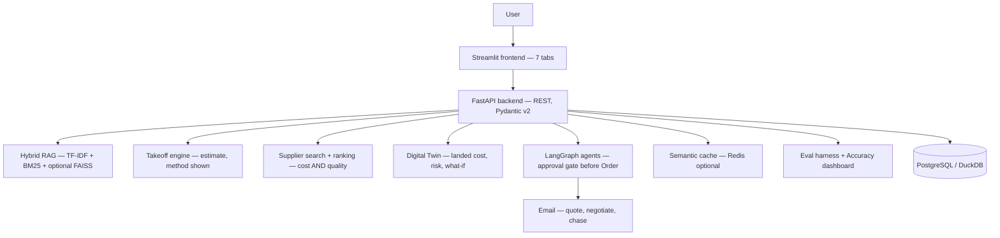

# BuildBuy Copilot

**One site, one buyer workflow.** Upload a construction plan — or just say
what you need — and BuildBuy Copilot reads the plan, estimates the
materials, finds nearby suppliers, simulates the purchase, messages
suppliers for quotes, negotiates within your limits, and brings you one
deal to approve. Nothing is ordered or paid without your tap.

- **Live app:** https://tu2tztzegjayuwzxudxbnv.streamlit.app/
- **GitHub:** https://github.com/deepthivj-aiml/buildbuy-copilot
  (branch `master`, main file `frontend/app.py`, Python 3.12)
- **Status:** live on Streamlit Community Cloud, verified with sample
  inputs 2026-11-10 (7 tabs load; see [Deploy](#7-deploy) and
  [`docs/DEPLOY.md`](docs/DEPLOY.md) §4 for the smoke test).
  The app runs in **Demo Mode** (synthetic data, no real email) until
  a backend is deployed.

**For:** freelance site engineers, solo architects, 1–3-person
contractors, small shop owners — anyone who needs materials for one
job this week, has no buying team, and cannot afford a late delivery
or a wrong quantity.

---

## 1. Quick start — running in under 15 minutes

### What you need

| What | Version / detail | Check |
|---|---|---|
| Python | **3.12.x** | `python --version` |
| Git | Any recent version | `git --version` |
| Docker Desktop (optional) | Latest, Compose v2 | `docker compose version` |
| Node.js | **Not needed** — the frontend is Python-only (Streamlit) | — |

### Step 1 — Clone and install

```bash
git clone https://github.com/deepthivj-aiml/buildbuy-copilot.git
cd buildbuy-copilot

python3.12 -m venv .venv
source .venv/bin/activate        # Windows: .\.venv\Scripts\Activate.ps1
python -m pip install --upgrade pip
pip install -r requirements.txt
```

In VS Code: Ctrl+Shift+P / Cmd+Shift+P → "Python: Select Interpreter" →
choose the `.venv` interpreter.

### Step 2 — Set up `.env` (never commit it)

```bash
cp .env.example .env   # Windows: copy .env.example .env
```

Fill in only the values you have. **The app runs with no keys at all**
— local TF-IDF + rules, no VLM — at $0. `LLM_API_KEY` (OpenAI **or**
Claude) and `RESEND_API_KEY` (only if `EMAIL_PROVIDER=resend`) are
optional, created by signing in to the provider with
deepthiag26@gmail.com. Check `git status` never lists `.env` before
committing.

### Step 3 — Run it (two terminals, no Docker)

```bash
# Terminal 1 — backend (FastAPI)
uvicorn app.main:app --reload --port 8000

# Terminal 2 — frontend (Streamlit)
streamlit run frontend/app.py --server.port 8501
```

| Service | URL | What you should see |
|---|---|---|
| Frontend | http://localhost:8501 | BuildBuy Copilot home screen |
| API docs | http://localhost:8000/docs | FastAPI Swagger UI |
| API health | http://localhost:8000/health | `{"status": "ok"}` |

Without Docker the database is the local SQLite file and the cache is
the in-memory fallback if Redis is not running. Without the backend,
the frontend runs in clearly-labelled **Demo Mode** on synthetic data.

### Step 3 (alternative) — Run it with Docker

```bash
docker compose up -d --build
docker compose ps          # api, frontend, db, redis all Up / healthy
docker compose logs -f api # Ctrl+C stops following, not the containers
docker compose down        # stops, keeps data
docker compose down -v     # stops AND wipes local data — only when you mean it
```

| Service | Port |
|---|---|
| `api` (FastAPI) | `8000` |
| `frontend` (Streamlit) | `8501` |
| `db` (Postgres 16) | `5432` |
| `redis` | `6379` |

### Step 4 — Check it works

1. Health: http://localhost:8000/health → `{"status": "ok"}`.
2. Frontend loads: http://localhost:8501 — home screen, no error banner.
3. Try the sample in [How to use it](#2-how-to-use-it-step-by-step)
   below — "steel brackets, 50 units, Fremont, by Friday, under $400".
4. Run the tests: `pytest -v` (see [Testing](#6-testing)).

If something fails, see [Common errors](#common-errors) below.

---

## 2. How to use it — step by step

The app has **7 tabs**, one buyer journey. Follow them in order.

### Step 1 — Start: say what you need

The chat **is** the input. Do one of these:

- **Type a requirement:** `steel brackets, 50 units, Fremont, by Friday, under $400`
- **Or type a quantity:** `concrete, 10 m3, Fremont`
- **Or upload a plan** (JPG/PNG/PDF, ≤10 MB) — or click
  **"Try with a sample plan — no upload needed"** (synthetic demo
  plan A-101).

Then click **"Parse my requirement"**, check the parsed fields
(item, quantity, unit, location, deadline, budget) and edit them if
needed. Location is a field **you** fill in — blank by default, never
tracked or auto-detected. Then click **"Find what I need →"**.

### Step 2 — Plan & Materials: check the takeoff

- Ask the Copilot about the plan. Every answer carries **dual
  citations** (highlighted plan region + exact spec clause) or an
  honest **"not found"** — never a bare answer.
- The takeoff table shows Material | Quantity | Unit | Method |
  Confidence. Every line is labelled
  **"estimate, not a surveyed quantity"**.
- **A typed requirement updates the takeoff:** typing
  `concrete, 10 m3` sets the concrete line to **10 m3** (the old plan
  value is kept in the method, never silently replaced). A new
  material adds a line; no quantity given means no line is invented.
  Loading a sample plan never discards a typed quantity.
- Edit a quantity and click **"Save edited takeoff"** — corrections
  feed the Accuracy tab.
- Click **"Find suppliers for these materials →"** to move on.

### Step 3 — Suppliers & Twin: pick on cost AND quality

- A ranked shortlist shows **cost AND quality per supplier**, with
  evidence for every quality score. A supplier with no evidence gets
  no invented rating — it shows as unknown.
- Best value = **0.45 × cost + 0.35 × quality + 0.20 × lead time**.
  The approval view shows **best-value, cheapest, and
  highest-quality side by side**, so you choose.
- The **digital twin** simulates the purchase before you spend:
  total landed cost, delivery date, cost risk **and** quality risk,
  with what-if sliders (price / date / quantity).
- **Total landed cost = goods (unit × quantity) + transport +
  taxes/fees (where known)**, with a per-supplier breakdown. Transport
  is optional and manual — type a delivery location yourself; blank
  means **"excl. transport"**. Suppliers whose MOQ is above your
  quantity are excluded, with the reason shown.
- Click **"Contact top 3 suppliers →"** to move on.

### Step 4 — Buyer Agent: check the email, then send

For each of the top 3 suppliers you see, **before anything is sent**:

1. **Contact details** — name, email, phone, address where held.
   A missing detail says **"not held"** — never invented.
2. **How they will be contacted** — channel (Email), from, to, subject.
3. **The full email preview** — it opens
   *"I am BuildBuy Copilot, acting as the buying agent for
   [customer]"* and enquires about your exact part + quantity.
4. **Edit it** — subject and body are editable. Click
   **"💾 Save edited email"** or **"↩ Reset to draft"**.
   Sending is disabled, with the reason shown, when a supplier's
   email is not held.
5. **Contact sharing** — the toggle **"Share my contact with this
   supplier"** is OFF by default (the email then says only
   "a customer"). Turn it ON per supplier to include your name,
   email and phone. The preview updates to match.
6. Click **"📧 Send to …"** per supplier, or **"Send quote requests
   to top 3"** (sends only to suppliers with an email held).

**One negotiation round** runs within the limits you set. Then the
**Approve / Reject** pane shows the best deal and the runner-up —
nothing is ordered until you tap **"✅ Approve this offer"**.

**If a supplier asks a question the agent cannot answer** from your
requirement (payment terms, a price beyond your limits, a spec,
delivery change, warranty…), it does **NOT guess**: the deal goes to
`NEEDS_CUSTOMER`, you are emailed the supplier's exact question, and
only after you answer does the agent reply to the supplier — in your
words. Questions it *can* answer from what you already stated are
answered straight from the requirement.

### Step 5 — My Orders: track it to the invoice

Full timeline: requirement → quotes → approval → order → delivery →
invoice. **"📧 Chase delivery"** follows up by email;
**"✓ Mark delivered"** is a human check (the app cannot prove
arrival). **"Export order (JSON)"** downloads the records.

Invoices are recorded **only from supplier-supplied data** — an
invoice needs a real `invoice_number` and `amount`; nothing is
auto-generated. An order reaches `INVOICE_RECEIVED` only when the
supplier sends one.

### Step 6 — Accuracy: is the copilot getting better or worse?

The observability dashboard shows **8 separate metrics, never blended
into one score** (groundedness, retrieval, answer accuracy, takeoff
estimate accuracy, supplier ranking, buyer-agent accuracy, guardrail
block rate, cost / cache / speed) — each with formula, source, n= and
target. Plus 4 headline cards, 2 trend charts with alert thresholds
as dashed lines, a per-module table, **Worst Answers** (10 lowest —
"Add to eval set" / "Mark fixed"), **Eval Run History**, and a
drill-down to raw events. Live data from the backend when it is up;
labelled synthetic demo data otherwise; **"no data yet"** when empty —
never an invented percentage. See [`docs/ARCHITECTURE.md`](docs/ARCHITECTURE.md) §10.

### Step 7 — Settings: your details, your data

Contact, sharing defaults, free-tier usage, BYO key status (never the
key value), data export / delete. Summary emails go to
deepthiag26@gmail.com after quotes received, deal approved, order
confirmed, and invoice received — with the full records export
(CSV / JSON / summary).

---

## 3. Skills Mapping

All 6 skills from the screenshots, where each one lives in this
product, what it does here, and how to see or test it.

| # | Skill | Where it lives | What it does here | See / test it |
|---|---|---|---|---|
| 1 | Hybrid Search RAG over Internal Docs | `app/rag/retrieval.py` (`HybridRetrieval`) | TF-IDF + BM25, fused with RRF; optional local sentence-transformers / FAISS embeddings when installed, silent fallback to TF-IDF + BM25 when not. Finds plan passages, spec clauses and supplier docs; answers carry citations or an honest "not found". | Plan & Materials tab: ask a plan question. `pytest tests/test_rag.py -v` |
| 2 | Agent Orchestration System | `app/agents/graph.py` (`BuyerGraph`) | LangGraph `StateGraph` when installed — Planner → Finder → Buyer → Negotiator → **human approval gate** → Order → Chaser → InvoiceTracker; deterministic local runner with the same gate when LangGraph is absent. | Buyer Agent tab: run a buyer flow and approve it. `pytest tests/test_backend.py -v` |
| 3 | Semantic Caching Layer | `app/cache/semantic_cache.py` (`SemanticCache`) | TF-IDF cosine + synonyms, plan-aware. Repeat plan / supplier questions are served with no LLM call; savings are shown. In-memory by default, Redis optional. | Ask the same plan question twice. `pytest tests/test_cache.py -v` |
| 4 | Automated Eval Dataset Generator | `app/evals/eval_gen.py` (`generate_eval_pairs`, `run_eval`) | Generates grounded Q&A eval pairs from plan metadata and supplier / quote records, dedupes them, quality-checks grounding, exports JSONL / CSV; the runner measures retrieval top-1/top-3, groundedness and guardrail block rate. | Accuracy tab: Eval Run History. `pytest tests/test_evals.py -v` |
| 5 | LoRA Fine-Tuning Pipeline | `app/lora/adapter.py` (`ToyLoRA`) | **Toy scale, labelled honestly:** numpy-only rank-2 adapter (r=2) that classifies a requirement into `plan_qa` / `takeoff` / `supplier_search` / `buyer`, trained on 12 synthetic examples. The real PEFT path (sentence-transformers + `peft.LoraConfig`, per-user training) is documented in the file — **not run**, needs PyTorch + PEFT + a GPU or patience. | `pytest tests/test_lora.py -v` |
| 6 | LLM Guardrails and Output Validation | `app/guardrails/guardrails.py` (`Guardrails`) | **Deterministic, no LLM decides:** PII redaction (regex; Presidio used only if installed), price cap, deadline, policy blocklist, never-pay check, contact-sharing check. Runs **before** the cache and **before** any email is sent, so a violating input can never be served a cached answer or emailed to a supplier. | Buyer Agent tab: try a price above your cap. `pytest tests/test_guardrails.py -v` |

**LLM / VLM status (honest):** no LLM or VLM key is configured and
none is needed for v1. Typed requirements are parsed by a deterministic
local parser (`frontend/helpers.py::parse_requirement`) with an
optional `llm_parser` hook for a free local model (Ollama) that falls
back to the deterministic parse on any error. Plan images are read by
the deterministic local fallback in `app/vlm/plan_vision.py`
(`VisionReader` reads structured plan data — no image pixels, no VLM
call); a real VLM plugs in behind the same `read_plan` interface.

---

## 4. Architecture in brief



Two invariants hold everywhere: **never pay** (no payment tool exists
in the codebase) and **never order without approval** (the graph
cannot reach `Order` without a persisted `ApprovalRequest` in
APPROVED status). Full architecture, data model, API list and the
agentic graph: [`docs/ARCHITECTURE.md`](docs/ARCHITECTURE.md).

**Modules — rebuild one alone:** every module has its own folder,
public interface and test file, and can be rebuilt without touching
the others. Map + per-module commands:
[`docs/MODULES.md`](docs/MODULES.md). Boundaries are enforced by
`tests/test_modularity.py`.

---

## 5. Look and feel

Light indigo theme (`.streamlit/config.toml`: primary `#4F46E5`,
background `#F8F7FF`, text `#1F2937`) with custom CSS in
`frontend/theme.py`: gradient hero banner (indigo → violet → teal) on
every tab, a 9-step buyer-journey stepper (Requirement → Materials →
Suppliers → Twin → Buyer agent → Approval → Order → Delivery →
Invoice), colour-coded status chips (best value green, cheapest blue,
highest quality purple, order/thread/metric statuses), card-style
supplier cards, gradient primary buttons and pill-style tab
navigation. Colour is decoration only — every chip and step keeps its
text label, demo data keeps its amber DEMO badge, and no colour implies
a real result. All 7 tabs are render-checked with Streamlit AppTest
(`tests/test_frontend.py::test_all_seven_tabs_render_after_restyle`).

---

## 6. Testing

```bash
pytest -v                              # all tests (temp SQLite DB, mock email)
docker compose exec api pytest         # same, inside Docker
python tests/self_test.py              # measured end-to-end summary, exit 0
```

**78 passed, 0 failed, 0 skipped** (commit `df622e4`). Tests use a
temp SQLite DB and the mock email backend — no real email, no network,
no invented data. CI (`.github/workflows/ci.yml`) runs pytest on every
push/PR with Python 3.12.

Per-module test commands are in [`docs/MODULES.md`](docs/MODULES.md);
measured results per file are in
[`docs/BUILD_REPORT.md`](docs/BUILD_REPORT.md) §3.

---

## 7. Deploy

**Live now — Streamlit Community Cloud (free, $0/month):**
https://tu2tztzegjayuwzxudxbnv.streamlit.app/
— repo `deepthivj-aiml/buildbuy-copilot`, branch `master`, main file
`frontend/app.py`, **Python 3.12** (set in Streamlit Settings; 3.14
fails on `psycopg-binary` / pandas). A push to `master` auto-redeploys;
if the first redeploy crashes on a stale pull, reboot the app from
Manage app for a fresh clone.

**Hugging Face: skipped.** The account exists
(https://huggingface.co/deepthivj-aiml) but a free Streamlit / Docker
Space needs PRO ($9/month), and the user chose Streamlit only — do
not pay for PRO or create a Space without a new explicit instruction.

Free-tier limits: Streamlit sleeps after inactivity; free DB/cache
tiers are small; Gmail has daily sending limits. Full plan + smoke
test: [`docs/DEPLOY.md`](docs/DEPLOY.md).

### Common errors

| Symptom | Fix |
|---|---|
| `Cannot connect to the Docker daemon` | Start Docker Desktop, wait for "Engine running" |
| `port is already allocated` (8000/8501/5432/6379) | Stop the other app, or change the host port in `docker-compose.yml` |
| `ModuleNotFoundError: No module named 'fastapi'` | Re-select the `.venv` interpreter; reinstall with the venv active |
| `.env` shows up in `git status` | Stop — fix `.gitignore` before any commit; rotate any key already committed |
| Streamlit "Connection refused" to the API | Start the API / `docker compose ps` — inside Docker the frontend talks to `http://api:8000` |
| Streamlit build fails on Python 3.14 | Set Python **3.12** in the app's Settings and rebuild |

---

## 8. Honest limits

- No real supplier contacts, quotes, ratings, or invoices are invented.
- Quantities are **estimates, not surveyed measurements**.
- No payment is handled; the buyer pays the supplier directly.
- Delivery cannot be proven by the app — the chase is an email
  follow-up; arrival stays a human check.
- Nothing is ordered, confirmed, or paid without your tap.
- Supplier quality scores are shown only with their evidence; no
  rating is ever invented for a real supplier.
- Free-tier limits apply on deploy (Streamlit sleep, small free
  DB/cache tiers, Gmail daily sending limits).
- No LLM/VLM key is configured by default; the plan reader is a
  deterministic local fallback (see Skills Mapping, skill 1 and 6,
  and [§3](#3-skills-mapping)).

---

## Docs

| Doc | What is in it |
|---|---|
| [`docs/ARCHITECTURE.md`](docs/ARCHITECTURE.md) | Full architecture, data flow, API list, data model, agent graph, cost + quality ranking |
| [`docs/MODULES.md`](docs/MODULES.md) | Module map: every module's files, public interface, rebuild/test alone |
| [`docs/BUILD_REPORT.md`](docs/BUILD_REPORT.md) | Integration + test pass report (measured counts, wiring, smoke tests) |
| [`docs/DEPLOY.md`](docs/DEPLOY.md) | Free deploy ($0), smoke test |
| [`docs/UAT.md`](docs/UAT.md) | Manual UAT checklist (74 items, phone-first) |
| [`docs/FREE_MODELS.md`](docs/FREE_MODELS.md) | Free/local models used by default and BYO paid options |
