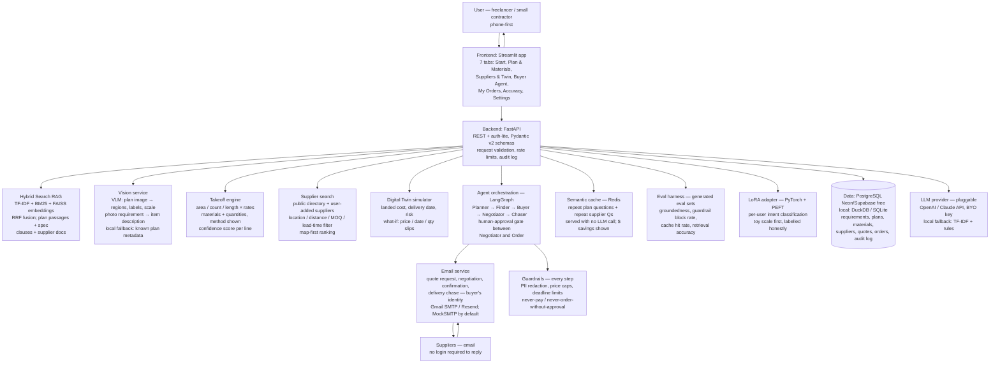

# BuildBuy Copilot — Architecture

Source of truth for the design: `UNIFIED_PLAN_ARCHITECTURE.md` and
`ARCHITECTURE_UI_REQUIREMENTS.md` in the parent project folder
(`~/workspace/projects/ai-engineer-supply-chain-consolidated/`). This file
adapts them for the built repo — same diagrams, same endpoints, same data
model, plus what the code actually does.

## 1. What it is

One site, one buyer workflow: upload a plan (image/PDF) or type/photograph
any requirement → cited copilot answers → estimated materials/quantities →
nearby suppliers ranked by **best cost AND quality** → per-decision
digital-twin simulation → buyer agent emails suppliers, negotiates once
within buyer-set limits → **one deal brought back for human approval** →
order confirmation → delivery chase → invoice tracking.

It will NOT pay, NOT order without approval, and NOT invent a supplier,
quote, contact, rating, or invoice.

## 2. System diagram



## 3. Agentic graph (LangGraph)

```
Planner → Finder → Buyer → Negotiator → [HUMAN APPROVAL GATE] → Order → Chaser
   ↑          ↑         ↑           ↑                |                    |
   └──── retry / re-plan on "not found" / no reply ──┘                    └→ end (DELIVERED / CHASED / INVOICE_RECEIVED)
```

- **Planner:** parses the requirement (items, qty, location, deadline,
  budget) into typed state; the user confirms/edits before proceeding.
- **Finder:** runs supplier search + twin simulation; returns the ranked
  shortlist + recommendation + runner-up.
- **Buyer:** drafts the quote-request email (shown to the user), applies
  contact-sharing toggles, sends to the top 3. Every email opens
  "I am BuildBuy Copilot, acting as the buying agent for [customer]"
  and enquires about the specific part + quantity (deadline / budget
  where given). With sharing OFF the customer is only "a customer" —
  no name, email or phone; with sharing ON for that supplier, the
  customer's name, email (deepthiag26@gmail.com) and phone
  (+1 341-252-9234) are included.
- **Negotiator:** parses supplier replies, checks them against buyer limits,
  runs one counter-offer round within cap/date, returns the best confirmed
  offer + runner-up. Cannot agree above the cap or after the deadline
  (code-enforced).
- **Escalation (supplier questions):** when a supplier asks a question
  the agent cannot answer from the requirement / limits (payment terms,
  a price beyond the cap, a spec, delivery changes, warranty — anything
  outside what the customer stated), the agent does NOT guess. The
  question is recorded, the deal goes to `NEEDS_CUSTOMER`, the customer
  is emailed at deepthiag26@gmail.com, and only the customer's reply —
  in their words, plus the agent identity line — is sent to the
  supplier (`app/agents/escalation.py`; endpoints
  `POST /buyer/supplier-question`, `GET /buyer/escalations`,
  `POST /buyer/escalations/{id}/reply`). Questions that only ask to
  confirm the part, quantity, location, deadline or budget already
  stated are answered straight from the requirement.
- **Human approval gate:** a hard state-machine gate, not a prompt
  instruction. Implemented as a persisted `ApprovalRequest` + LangGraph
  `interrupt_before=["order"]`, plus a DB check in the order node as a
  second lock. The graph cannot transition to Order without an `approve`
  event from the user.
- **Order:** sends the confirmation email; writes the order
  (PENDING → APPROVED → CONFIRMED).
- **Chaser:** on the promised date, if delivery is not confirmed, sends a
  chase email; logs the chase; cannot confirm delivery itself.
- **InvoiceTracker:** after confirmation, records invoices **only from
  supplier-supplied data** (invoice number + amount, no defaults, no
  auto-generation) and chases overdue / never-sent invoices.

Each node has typed state (Pydantic), each transition is logged to
`audit_log`, and any node can return to Planner on "not found" / no reply.
One approved deal sends exactly one supplier email: outbox rows use
deterministic idempotency keys `email:{deal}:{supplier}:{round}`.

## 4. Data flow end-to-end (one purchase)

| Step | Input | Service | Output | Stored |
|---|---|---|---|---|
| 1. Start | **The chat is the input:** plan image/PDF, or typed/photographed part/requirement in chat, then quantity + optional location + deadline + budget as follow-up prompts | Frontend chat → API validation (file type, size ≤10 MB, PII scan) | Requirement object (items, qty, location, deadline, budget) | `requirements` |
| 2. Plan Q&A | Question + plan + specs | Scale-confirm gate → VLM (regions/labels) + Hybrid RAG (passages) + Guardrails | Answer + image-region citation + spec-clause citation, or "not found" | Q&A log + citations |
| 3. Takeoff | Plan regions + scale hint | Takeoff engine (area/count/length × rates) + confidence scoring | Materials list with quantities, method per line, "estimate" label, flagged low-confidence lines | `materials` |
| 4. Supplier search | Materials/requirement + location + qty | Supplier search (public + user-added) + Hybrid RAG over supplier docs | Ranked shortlist (3–5) with distance, lead time, MOQ, landed cost, fit, quality + evidence | `suppliers` + `shortlist` |
| 5. Twin simulation | Shortlist + qty + deadline | Digital Twin (landed cost, date, cost risk + quality risk, what-if) | Simulation per supplier + ranked recommendation + runner-up | `simulations` |
| 6. Buyer contact | Top 3 + buyer limits + contact-sharing toggles | Buyer Agent (LangGraph) → draft shown → Email service | Quote-request emails sent as "BuildBuy Copilot, acting as the buying agent for [customer]" — contact only when that supplier's toggle is ON | `outreach` + email log |
| 6b. Supplier question | Supplier reply asking something outside the requirement | Escalation (`app/agents/escalation.py`) | Answerable from the requirement → answered; otherwise NEEDS_CUSTOMER, customer emailed, supplier reply only after the customer's answer, in their words | `messages` + `outreach` (NEEDS_CUSTOMER) + audit log |
| 7. Negotiation | Supplier replies (parsed) + limits | Negotiator agent (one round, within cap/date) | Best confirmed offer + runner-up | `quotes` |
| 8. Approval | Offer + simulation | Human-approval gate (UI) | Approve / Reject | `orders` (PENDING → APPROVED/REJECTED) |
| 9. Confirm + chase | Approved order | Buyer Agent → confirmation email; Chaser agent on promised date | Order confirmation; delivery-chase email if overdue | `orders` + audit log |
| 10. Invoice | Supplier sends an invoice | InvoiceTracker records supplier-supplied number + amount | Order status INVOICE_RECEIVED | `invoices` |
| 11. Audit | Every step | Audit log (JSONL + DB) | Full timeline: who/what/when, every quote and message | `audit_log` |

## 5. Cost AND quality ranking (2026-11-10 update)

**The best supplier is the best cost AND quality supplier — not cost alone.**

### 5.1 Best-value formula (live search path)

The supplier search (`app/suppliers/search.py`) ranks by:

```
best value = 0.45 × cost score + 0.35 × quality score + 0.20 × lead-time score
```

Each component is normalised 0–100 across the shortlist (min-max;
cheapest landed cost = 100, shortest lead = 100). Cost leads, quality is
close behind, lead time breaks near-ties. Cost alone never wins the
best-value rank.

The cheapest option and the highest-quality option are identified
separately and shown **side by side with the best-value pick** — on the
Suppliers & Twin screen and on the approval pane — so the user chooses
between three honest options instead of being handed one answer.

### 5.2 Quality — evidence-only rule (non-negotiable)

- A quality score exists **only where there is evidence**: certifications,
  verified reviews, past-order records (on-time rate, defect rate, with
  sample size `n=`).
- A supplier with no quality evidence gets `quality_score = null` and
  `quality_unknown = true`. It is scored on cost + lead only, flagged
  visibly as "quality unknown" — **never an invented rating, never an
  average filled in from nothing, never a "typical" default**.
- Evidence is shown with the score, every time: the score without its
  evidence is not shown. If the evidence is weak (e.g. n=12 orders,
  no certificate on file), the evidence says so.
- When NO supplier in a shortlist has evidenced quality, best value falls
  back to the cost rank and the result is flagged
  (`no_quality_evidence=True`).
- Suppliers whose MOQ is above the job quantity are **excluded** from the
  ranked shortlist and listed separately with the reason (e.g. "quantity
  50 below MOQ 100") — never silently dropped, never ranked on a quantity
  they will not sell. A cheap per-unit price behind an unmeetable MOQ is
  the classic trap this rule prevents.

### 5.3 Twin: cost risk AND quality risk

The twin (`app/ranking.py::simulate_cost_and_quality`, mirrored in the
frontend demo) simulates both:

```
what-if landed cost = (base landed − transport) × (1 + qty%) × (1 + price%) + transport
quality risk: no evidence = 60; score ≥ 80 = 10; 60–79 = 30; < 60 = 55
              (+10 per risk flag)
cost risk    = min(50, |price%| × 2 + |qty%| × 0.5)
lead risk    = min(30, slip days × 5 + max(0, lead − 14))
overall risk = 0.5 × quality risk + 0.3 × cost risk + 0.2 × lead risk
```

The transport line is NOT scaled by the price what-if — freight does
not rise with the unit price — it is added back after the goods/fees
portion is scaled. Cheap but late or low quality = higher total risk,
because rework + delay compound. The quality-risk component and its
plain-language reason are shown separately from the total, so the signal
is visible even when the totals are close.

### 5.4 Total landed cost — optional transport (2026-11-11 update)

```
total landed cost = goods (unit price × quantity)
                  + transport (distance × rate, when a delivery location is given)
                  + taxes/fees (2% handling + $15 admin, where known)
```

Transport is **optional and manual**: the buyer types a delivery
location themselves (city / ZIP / address) into an optional field that
is **blank by default**. Only then is distance + transportation cost
computed and included in total landed cost, shown as a separate line
with a per-supplier breakdown (goods / transport / taxes-fees / total),
so the user can see why one supplier wins on total landed cost even
when its unit price is higher — the near supplier can beat the far
cheap one once freight is counted. The buyer can toggle transport off
or enter their own $/km rate. Blank means the landed cost is labelled
**"excl. transport"** and ranking works without it.

Privacy (non-negotiable): **no auto-detection** — no browser
geolocation API, no IP lookup, no device location, and the
requirement's job-site location is NOT auto-used for transport. The
delivery location is a separate, explicit, user-typed input, resolved
offline against a small built-in city table (`app/suppliers/location.py`)
plus `lat,lng` input; an unrecognised place excludes transport and says
so, never guesses. Implemented in `app/suppliers/search.py`
(`landed_cost_breakdown`), `app/twin/simulator.py` (`DigitalTwin`),
`app/ranking.py::simulate_cost_and_quality` (transport line), the
`/simulate` endpoint + approval pane (`transport_cost`,
`transport_included`, `landed_cost_label`), and the Streamlit Suppliers
tab.

This mirrors the Total Landed Cost work Deepthi did at Ford Motor
Company (Supply Chain Analytics, 2023–2025): the same discipline —
compare suppliers on the **full** landed cost, not the unit price —
applied here to one purchase by a freelancer or small contractor. At
Ford that meant total landed cost across hundreds of locations with
shipping, fees and business constraints; here it is the same formula
at single-job scale, with the transport line made explicit and
optional because a small buyer often does not know it yet.

### 5.5 Ranking reconciliation (2026-11-11 — resolved)

The backend previously carried **two** best-value definitions; the
integration pass reconciled them to ONE:

| Location | Formula |
|---|---|
| `app/suppliers/search.py::best_value_score` — **canonical** | 0.45 cost + 0.35 quality + 0.20 lead |
| `app/ranking.py::rank_shortlist` | imports `best_value_score` from `search.py` (no second formula) |
| `.env.example` / `app/config.py` (`VALUE_WEIGHT_COST` / `VALUE_WEIGHT_QUALITY` / `VALUE_WEIGHT_LEAD`) | 0.45 / 0.35 / 0.20 — defaults match the canonical weights |

`rank_shortlist` keeps its ratio-based cost score (0–100) and its
evidence-only quality handling, but the blend is the canonical one:
cost and quality are scaled to 0–1, the lead score is min-max
normalised from `lead_time_days` when present (neutral 0.5 for every
entry when no entry carries a lead time, so the lead term cannot change
the order), and the result is scaled back to 0–100 for display. The
demo shortlist still gives three distinct winners (best value Alameda
Concrete Supply, cheapest Central Valley Aggregate Co, highest quality
Bay Area Building Supply). The old 0.50/0.50, no-lead blend is gone;
there is no second formula left in the repo.

## 6. API endpoints

| Method + path | Purpose |
|---|---|
| `POST /requirements` | Create a requirement (typed/photo/plan) — returns parsed fields for user edit |
| `POST /requirements/{id}/plans` | Upload plan image/PDF + specs (≤10 MB, ≤25 sheets) |
| `POST /requirements/{id}/plans/{plan_id}/scale-confirm` | Confirm / correct scale before any measurement |
| `POST /requirements/{id}/ask` | Copilot Q&A — answer + dual citations or "not found" |
| `GET /requirements/{id}/materials` | Materials takeoff table (method, confidence, flags) |
| `PATCH /requirements/{id}/materials/{material_id}` | Edit a material line before supplier search |
| `POST /requirements/{id}/materials/rerun` | One free re-run with feedback |
| `GET /requirements/{id}/suppliers` | Ranked shortlist + map data (distance, lead time, MOQ, landed cost, fit, quality) |
| `POST /requirements/{id}/suppliers` | Add a supplier by hand (name + contact + source URL) |
| `GET /requirements/{id}/suppliers/{supplier_id}` | Supplier record / card (contact only if public/supplier-provided) |
| `POST /requirements/{id}/simulate` | Digital-twin simulation + what-if (price/date/qty) for top 3 |
| `POST /requirements/{id}/buyer/draft` | Generate quote-request draft for top 3 (shown before sending) — agent identity, part + quantity, contact only if shared |
| `POST /requirements/{id}/buyer/send` | Send quote-request emails (contact-sharing toggles applied; OFF strips name/email/phone entirely) |
| `GET /requirements/{id}/buyer/inbox` | Buyer inbox: threads, statuses, no-reply list |
| `POST /requirements/{id}/buyer/supplier-question` | Supplier asked a question — answered from the requirement, or escalated (NEEDS_CUSTOMER, customer emailed, no supplier reply) |
| `GET /requirements/{id}/buyer/escalations` | Supplier questions still waiting for the customer |
| `POST /requirements/{id}/buyer/escalations/{id}/reply` | Customer answers in their words; agent sends it to the supplier |
| `POST /requirements/{id}/buyer/negotiate` | One negotiation round within buyer-set limits |
| `GET /requirements/{id}/approval` | Approval pane: best-value vs cheapest vs highest-quality, side by side |
| `POST /requirements/{id}/approve` | Human approval (Approve/Reject) — the only path to an order |
| `POST /requirements/{id}/confirm` | Send order confirmation after approval |
| `POST /requirements/{id}/chase` | Delivery-chase email on promised date |
| `POST /requirements/{id}/invoice` | Record an invoice — supplier-supplied number + amount only |
| `POST /requirements/{id}/invoice/chase` | Chase an overdue / never-sent invoice |
| `POST /requirements/{id}/summary` | Email summary to the user (quotes / approval / confirmation / invoice) |
| `GET /requirements/{id}/records?format=csv\|json\|summary` | Full records export (requirement → invoice + audit log) |
| `GET /orders` | My Orders timeline (filterable) |
| `GET /orders/{id}` | Single order + full audit trail |
| `GET /settings` / `PATCH /settings` | Contact, sharing defaults, buddy personalisation, usage, BYO key status |
| `POST /settings/contact-sharing/{supplier_id}` | Toggle contact sharing for one supplier (default OFF) |
| `GET /health` | Liveness (deploy smoke test) |

## 7. Data model

```
users(id, name, email, phone, created_at, free_tier_quota, byo_key_set BOOL)
requirements(id, user_id, source_type [plan|typed|photo], raw_text, items JSON,
             location, quantity, deadline, budget, status, created_at)
plans(id, requirement_id, file_name, file_type, sheets INT, scale, scale_confirmed BOOL,
      spec_text, created_at)
materials(id, requirement_id, plan_id, material, quantity DECIMAL, unit,
          method TEXT, confidence DECIMAL, flagged BOOL, estimate_label BOOL DEFAULT TRUE)
suppliers(id, name, location, lat, lng, email, phone, address, contact_source
          [public|supplier_provided|user_added], contact_source_url, moq, lead_time_days,
          certifications JSON, risk_flags JSON, verified BOOL, created_at)
shortlist(id, requirement_id, supplier_id, rank INT, unit_price DECIMAL,
          landed_cost DECIMAL, fit_score DECIMAL, quality_score DECIMAL,
          quality_evidence JSON, why_rank TEXT)
simulations(id, requirement_id, supplier_id, landed_cost, delivery_date, risk_score,
            quality_risk DECIMAL, what_if JSON, recommendation BOOL, created_at)
outreach(id, requirement_id, supplier_id, channel [email], draft TEXT, sent_at,
         contact_shared BOOL, status [sent|replied|no_reply|agreed])
quotes(id, requirement_id, supplier_id, unit_price DECIMAL, total DECIMAL,
       lead_time_days INT, terms TEXT, received_at, source [email_reply|manual])
orders(id, requirement_id, supplier_id, quote_id, status
       [PENDING|APPROVED|REJECTED|CONFIRMED|DELIVERED|CHASED|INVOICE_RECEIVED],
       approved_at, confirmed_at, promised_date, created_at)
invoices(id, order_id, invoice_number TEXT, amount DECIMAL, received_at,
         source [supplier_email|manual], created_at)
qa_log(id, requirement_id, question, answer, citation_image_region JSON,
       citation_spec_clause TEXT, grounded BOOL, thumbs INT)
audit_log(id, requirement_id, actor [user|agent|supplier], action, detail JSON, created_at)
outbox(id, idempotency_key UNIQUE, deal_id, supplier_id, round, payload JSON,
       status [pending|sent|failed], created_at)
approval_requests(id, requirement_id, deal_id, status [PENDING|APPROVED|REJECTED],
                  created_at, decided_at)
observability_events(id, request_id, user_id, requirement_id, step,
  [ask|takeoff|supplier_search|twin|buyer_send|negotiate|approve|chase],
  model, tokens_in INT, tokens_out INT, latency_ms INT,
  citations JSON, grounded BOOL, cache_hit BOOL,
  guardrail_action [allow|redact|block], guardrail_reason TEXT,
  cost_usd DECIMAL, created_at)
metrics_daily(id, user_id, date, groundedness DECIMAL, retrieval_top1 DECIMAL,
  thumbs_up_rate DECIMAL, takeoff_mape DECIMAL, ranking_top1_rate DECIMAL,
  reply_rate DECIMAL, approval_rate DECIMAL, guardrail_block_rate DECIMAL,
  cache_hit_rate DECIMAL, cost_per_job_usd DECIMAL, latency_p95_ms INT,
  eval_pass_rate DECIMAL, computed_at)
eval_runs(id, eval_set, groundedness DECIMAL, retrieval_top1 DECIMAL,
  guardrail_block_rate DECIMAL, cache_hit_rate DECIMAL, run_at)
```

## 8. Skills mapping — all 6 screenshot skills

| Reel skill | Module | File | What it does here |
|---|---|---|---|
| 1. Hybrid Search RAG | Plan + spec retrieval; supplier-doc retrieval | `app/rag/retrieval.py` | TF-IDF + BM25 + FAISS, RRF fusion; cited answers (image region + spec clause; supplier doc + quote) |
| 2. Agent Orchestration | Buyer workflow graph | `app/agents/graph.py` (LangGraph) | Planner → Finder → Buyer → Negotiator → Chaser, with human-approval gate |
| 3. Semantic Caching | Repeat-question cache | `app/cache/semantic_cache.py` (Redis) | TF-IDF cosine + synonyms; repeat plan/supplier questions served with no LLM call; $ savings shown |
| 4. Automated Eval Dataset Generator | Eval harness | `app/evals/eval_gen.py` | Generates grounded Q&A pairs from plan metadata and supplier/quote records; dedupe + quality check; JSONL/CSV export; regression gate in CI |
| 5. LoRA Fine-Tuning | Personal intent adapter | `app/lora/adapter.py` (PyTorch + PEFT) | Small rank-2 adapter tuned on the buyer's own past requirements/replies (synthetic first); intent classification; toy scale labelled honestly |
| 6. LLM Guardrails | Guardrail layer | `app/guardrails/guardrails.py` (Guardrails AI + Presidio) | PII redaction, price-range checks, policy blocklist, deadline/price caps, never-pay / never-order-without-approval; runs before cache and before email |

## 9. Frontend — 7 tabs (Streamlit)

1. **Start** — upload plan (≤10 MB) or type/photograph a requirement; parsed
   preview editable; free-tier counter; one primary action.
2. **Plan & Materials** — Copilot chat with dual citations or "not found";
   takeoff table with "estimate, not a surveyed quantity", confidence flags,
   CSV export.
3. **Suppliers & Twin** — ranked shortlist (Supplier | Unit | MOQ | Lead |
   Fit + quality + evidence), map-like distance list, twin simulator with
   what-if sliders (price/date/qty) showing cost risk AND quality risk,
   recommendation + runner-up, best-value vs cheapest vs highest-quality
   side by side, MOQ-excluded suppliers listed with reasons.
4. **Buyer Agent** — 3-column inbox (thread list / message thread / supplier
   info), draft email shown before sending, per-supplier contact-sharing
   toggle (default OFF, labelled "Share my contact with this supplier"
   with a plain-words explanation of what is shared when ON and what the
   supplier sees when OFF), negotiation limits, Approve/Reject pane showing
   best-value vs cheapest vs highest-quality, "we never handle payment".
   A "needs you" panel lists supplier questions the agent could not
   answer — the customer answers there and the agent sends their words
   to the supplier.
5. **My Orders** — timeline requirement → plan → materials → suppliers →
   quotes → negotiation → approval → order → delivery → invoice, with
   INVOICE_RECEIVED state; invoice details recorded only from the supplier;
   chase buttons; records export.
6. **Accuracy** — observability dashboard: 4 headline cards (groundedness /
   thumbs-up rate / takeoff mean error / cost per job, each with n=), 2 trend
   charts, per-module table, Worst Answers list, Eval Run History. All
   numbers measured or labelled synthetic; "no data yet" when empty.
7. **Settings** — contact, sharing defaults, free-tier usage, BYO key status
   (never the key value), data export/delete.

Without a backend the frontend runs in clearly-labelled **DEMO MODE** on
synthetic in-memory data — no paid key, no real email. With the backend up
at `API_URL` (default `http://localhost:8000`) it switches to LIVE MODE.

## 10. Observability — Accuracy dashboard

Defined in the plan (§9): per-request structured JSON logs (`request_id`,
step, model, tokens, latency, citations, grounded, cache_hit,
guardrail_action, cost) with PII redacted before logging; daily rollup
into `metrics_daily`; the Streamlit Accuracy tab reads `metrics_daily` +
`eval_runs` + `qa_feedback`. No blended single accuracy score. Alerts
are computed daily from `metrics_daily` (proposed thresholds in the plan,
user-changeable in Settings). Prometheus/Grafana are Phase 2 only.

### 10.1 The 8 metrics (separate, never blended)

`app/observability.py::METRIC_DEFS` is the single source of truth; the
frontend mirrors it in `frontend/accuracy.py::METRIC_DEFS`, and
`tests/test_frontend.py::test_accuracy_metric_defs_agree_with_backend`
fails if the two copies drift apart.

| # | Metric (key) | Formula | Source | Target (alert below) |
|---|---|---|---|---|
| 1 | Groundedness (`groundedness`) | grounded answers ÷ all answers | `qa_log` (grounded flag) | ≥ 95% (< 90%) |
| 2 | Retrieval accuracy (`retrieval_top1`) | RAG top-1 correct ÷ eval set (top-3 shown alongside) | `eval_runs` (fixed eval set) | top-1 ≥ 90% (< 85%) |
| 3 | Answer accuracy (`thumbs_up_rate`) | 👍 ÷ (👍 + 👎); "not found" counted separately, never as a wrong answer | `qa_log` (thumbs) | ≥ 90% |
| 4 | Takeoff estimate accuracy (`takeoff_mape`) | mean absolute % error vs user-corrected quantities | corrected takeoff lines — **NULL today**: edits overwrite the quantity in place, so no corrected-vs-estimate pair is recorded yet; the dashboard shows "no data yet" instead of inventing one | mean error ≤ 10% (> 20%) |
| 5 | Supplier ranking accuracy (`ranking_top1_rate`) | chosen supplier was ranked #1 | `orders` joined to `shortlist` | ≥ 50% (< 40%) |
| 6 | Buyer-agent accuracy (`buyer_agent`) | quotes agreed ÷ sent; **approval-before-order = 100%** (state-machine invariant) is the metric value; the agreement rate is shown separately, never blended in | `outbox` / `quotes` / `approval_requests` / `orders` | approval-before-order 100% |
| 7 | Guardrail block rate (`guardrail_block_rate`) | blocked ÷ adversarial inputs; live false-positive rate tracked separately | `eval_runs` + `observability_events` | 100% on the adversarial set, FP < 5% |
| 8 | Cost / cache / speed (`cost_cache_speed`) | cache hit rate, $ saved, latency p50/p95, cost per query / per job | `observability_events` | cache hit ≥ 50%, p95 ask latency < 10 s |

### 10.2 What the tab shows

`GET /accuracy` (`app/api/routes.py`) returns `AccuracyDashboardOut`:
`metrics` (the 8, each with formula/source/n/target/status),
`headline` (4 cards: groundedness, 👍 rate, takeoff error, cost per job
— the same 4 metrics, not a different score), `trends` (30 days of
`metrics_daily`), `per_module`, `worst_answers` (10 lowest:
thumbs-down first, then ungrounded), `eval_runs`, `raw_events`
(PII-free fields only: request_id, step, model, latency, grounded,
cache hit, guardrail action, cost — no prompts, plan text or email
bodies), `alerts`, `approval_before_order`. `build_accuracy_dashboard(db,
days=30)` windows every count to the requested window. Empty metrics
are `null` → the UI shows "no data yet".

`POST /accuracy/worst-answers/{qa_log_id}/action` with
`{"action": "add_to_eval_set" | "mark_fixed"}`: "add to eval set"
appends the labelled QA pair to `data/evals/worst_answers_eval.jsonl`
(deduped by `qa_log_id`) and writes an `AuditLog` entry; "mark fixed"
audits only. A repeat action returns **409** (`error: "already
recorded"`) — never a duplicate eval entry. Unknown action → 400 (or
422 from the schema); missing QA row → 404.

The tab (`frontend/app.py`, "6 · Accuracy", pure helpers in
`frontend/accuracy.py`): live mode fetches `GET /accuracy` when the
backend answers `/health` and shows a LIVE badge; otherwise it shows
labelled synthetic demo data from `frontend/demo_data.py`
(`DEMO_ACCURACY`, 10 Worst Answers, 10 raw events) with a "Clear demo
metrics" button that renders the empty state. Trend charts are Altair
with the alert thresholds as **dashed red rules** (groundedness 90%,
retrieval top-1 85%, eval pass 90%, p95 latency 10 s), falling back to
`st.line_chart` when Altair is not installed. Demo thumbs-down feedback
is merged into the Worst Answers list and demo actions are noted in
session state only — nothing is written to the eval set in demo mode.

The loop is: evals → dashboard → Worst Answers / failing items → fix
→ re-run evals → the dashboard shows whether it improved. The
dashboard never changes the product by itself.

## 11. Security / guardrails

- Guardrails run **before** the cache and **before** any email is sent.
- PII redaction (Presidio) on LLM prompts and outbound emails unless the
  user toggled contact-sharing ON for that supplier.
- Price caps and deadline limits enforced in code, not just in the prompt.
- Never-pay / never-order-without-approval is a state-machine invariant.
- `.env` in `.gitignore` from the first commit; `.env.example` (names only)
  committed instead; no key/token/password/OTP in code, docs, chat, or the
  tracker. No user data used to train a shared model.

## 12. Module map — rebuild one module at a time (2026-11-11)

The build is split into separate sections/modules with clear boundaries,
so each module can be rebuilt / tested / replaced alone. Full map with
per-module rebuild/test commands: [`docs/MODULES.md`](MODULES.md).

| # | Module | Files | Public interface (`__init__.py` + `__all__`) |
|---|---|---|---|
| 1 | RAG / retrieval | `app/rag/` | `HybridRetrieval`, `load_plan_corpus`, `build_plan_corpus` |
| 2 | VLM / plan parsing | `app/vlm/` | `VisionReader`, `describe_plan`, `detect_scale`, `answer_about_plan` |
| 3 | Takeoff engine | `app/takeoff/` | `compute_takeoff`, `verify_reconciliation`, `TakeoffResult` |
| 4 | Supplier search | `app/suppliers/` | `search_suppliers`, `geocode_location`, `best_value_score`, `landed_cost_breakdown` |
| 5 | Digital Twin | `app/twin/` | `DigitalTwin`, `Simulation`, `shipping_cost_usd` |
| 6 | Ranking | `app/ranking.py` | `rank_shortlist`, `simulate_cost_and_quality` |
| 7 | Buyer Agent / orchestrator | `app/agents/` | `BuyerGraph`, `finder_node`, `approval_gate_node` |
| 8 | Email service | `app/email/` | `EmailService`, `drain_outbox`, `idempotency_key` |
| 9 | Guardrails | `app/guardrails/` | `Guardrails`, `GuardrailResult` |
| 10 | Semantic cache | `app/cache/` | `SemanticCache`, `normalize` |
| 11 | Evals | `app/evals/` | `generate_eval_pairs`, `run_eval`, `quality_check` |
| 12 | LoRA | `app/lora/` | `ToyLoRA`, `INTENTS` |
| 13 | Observability / Accuracy | `app/observability.py` | `METRIC_DEFS`, `compute_daily_metrics`, `build_accuracy_dashboard`, `record_worst_answer_action` (+ `GET /accuracy`, `POST /accuracy/worst-answers/{id}/action`) |
| 14 | Records / summaries | `app/records/` | `build_records`, `build_export`, `to_csv`, `to_json` |
| 15 | Frontend | `frontend/app.py`, `helpers.py`, `demo_data.py`, `accuracy.py` | pure helpers tested without Streamlit (`tests/test_frontend.py`); Accuracy tab render-checked with Streamlit AppTest when Streamlit is installed |

Rules enforced by `tests/test_modularity.py`:

- Modules talk through `app/schemas.py`, `app/config.py`, `app/db/`, or
  the documented edges only. `app/integrations.py` is the ONE wiring
  module allowed to import every AI module; the API layer imports it.
- The canonical best-value formula lives in module 4
  (`app/suppliers/search.py::best_value_score`); module 6 imports it.
- No auto-location code anywhere; torch/faiss are optional (try/except)
  imports only, never hard imports.
- The frontend's 7 screens still live in `frontend/app.py`; the pure
  logic is split out (`helpers.py`, `demo_data.py`). A `screens/`
  package split is a follow-up (needs Streamlit + AppTest to verify).
